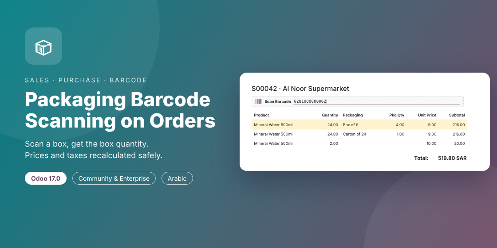

# Order Line Packaging Barcode Scanning (Odoo 17.0)

Scan packaging and product barcodes straight into **Sales quotations** and **Purchase RFQs**.
The line gets the right product, unit, quantity and price — no typing, no quantity mistakes.



## Branches

| Branch | Odoo | Notes |
|---|---|---|
| [`16.0`](../../tree/16.0) | 16.0 | Original version (default branch) |
| [`17.0`](../../tree/17.0) | 17.0 | View `attrs` → expressions, new settings layout, `locked` sales orders |
| [`18.0`](../../tree/18.0) | 18.0 | `<tree>` → `<list>`, product `type` instead of `detailed_type` |
| [`19.0`](../../tree/19.0) | 19.0 | Packagings are units of measure (`product.uom` barcodes) |

Use the branch that matches your Odoo version; the module's technical name is the same in all of them.

## Features

- Independent **Packaging Barcode Scanning** switches in Sales and Purchase settings (per company, off by default).
- Scan anywhere on the order form with a USB/Bluetooth scanner, type into the **Scan Barcode** box, or type a barcode into a line's **Barcode** column.
- Resolution order: packaging barcode first (`product.packaging` barcodes), then the product barcode — each an indexed lookup.
- A packaging scan adds the packaging's **contained quantity** in the product unit (4 scans of *Box of 6* = 24 Units, packaging *Box of 6*, packaging quantity 4).
- A product scan adds 1 product unit; scanning the same barcode again increases the same line.
- Odoo's own pricelist, vendor price and tax rules recompute the line; purchase lines keep the scanned quantity even though Odoo resets it to the vendor minimum on product change.
- Non-blocking notifications for unknown barcodes, wrong company, packagings not allowed, missing partner, locked orders, product warning messages.
- Arabic (`ar_001`) translation, RTL-ready styling.

## Installation

1. Copy the `order_line_packaging_barcode` folder into your addons path (or add this repository as an addons path).
2. Update the apps list and install **Order Line Packaging Barcode Scanning**.
3. Enable it in *Sales › Configuration › Settings* and/or *Purchase › Configuration › Settings*.

Depends on: `sale`, `purchase`, `barcodes` (standard). Community and Enterprise.

## Tests

20 automated tests (`TransactionCase`, tag `olpb`):

```
odoo-bin -d <db> -i order_line_packaging_barcode --test-tags /order_line_packaging_barcode --stop-after-init
```

## Author & license

[Ibrahim Yahia](https://www.linkedin.com/in/ibrahim-yahia) · LGPL-3

